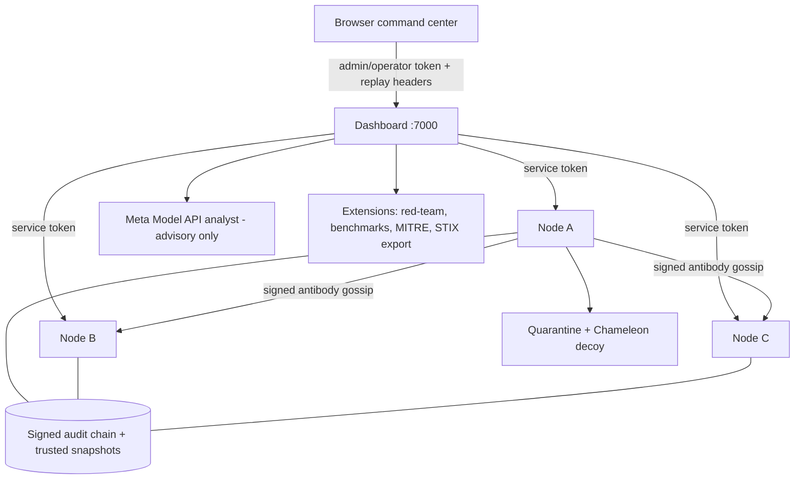

# AegisQuorum

A production-grade autonomous bio-digital defense grid built with Node.js. It combines signed policy updates, threshold approvals, integrity monitoring, tamper detection, quarantine, verified rollback, audit chains, an evidence-grounded Meta Model API incident analyst, and a command-center dashboard.

## Pitch

AegisQuorum is an autonomous "bio-digital immune system" for a three-node edge cluster. When tampering is detected, the affected node quarantines itself, becomes a Chameleon decoy honeypot, and gossips a signed threat antibody that inoculates its peers — while a human-gated 2-of-3 passkey quorum decides whether the AI-synthesized healing policy may apply. Every step is anchored to an Ed25519-signed, hash-chained audit ledger that can be verified independently.

## Try it in 60 seconds

```bash
npm ci
npm start          # dashboard on http://127.0.0.1:7000
```

1. Click **1-Click Load Dev Admin Token** (local, HttpOnly session; the token is never exposed to the page).
2. Click **▶ RUN AUTONOMOUS DEMO** and watch the seven-stage timeline: tamper → decoy → gossip → forensics → synthesis → quorum → recovery.
3. In the **⚔ Red vs Blue** panel, press **▶ Run Red Team** — five simulated attacks (tamper, replay, 1-of-3 approval, wrong token, decoy probe) are fired at isolated temporary nodes and blocked live.
4. Run `npm run benchmark` and press **↻ Refresh** in the Benchmarks card to see MTTD/MTTR and audit-chain verification timings.

No cloud account, model key, or external service is required; everything falls back deterministically.

## Architecture



On single-port hosts (Render), the three nodes run as in-process virtual nodes and all inter-node traffic is routed internally; localhost keeps real HTTP node services on ports 7101-7103.

## Benchmarks

Indicative local run (`npm run benchmark`, temporary state, test keys; your numbers will vary):

| Metric | Value |
| --- | --- |
| MTTD (tamper → detect) | 15 ms |
| MTTR (quarantine → verified recovery) | 11 ms |
| Approval verification (2-of-3) | 3 ms |
| Audit-chain verification (100 events) | 14 ms |
| Audit-chain verification (1000 events) | 236 ms |
| False positives over 50 clean scans | 0 |

## Responsible AI

The Meta Model API analyst is **advisory only**: it cannot authorize, execute, or mutate anything. It receives only bounded, sanitized, independently verified audit projections; its structured output is schema-validated locally and every evidence citation must resolve to a real event ID. MITRE ATT&CK tags are attached after validation from a static, hand-reviewed map in `src/mitre.js` — never generated by the model. Missing credentials or provider failures degrade to a deterministic fallback with an explicit provider status, and no API key, private key, or raw audit proof ever leaves the server.

## Hackathon Rule 4: New Work Only

| Pre-Existing Base MVP Scaffold | Newly Engineered During Meta Hackathon (Oct 26 - Nov 4) |
| --- | --- |
| Three-node local security service and dashboard | Chameleon decoy honeypot, signed threat fingerprints, and model-aware synthetic responses |
| Ed25519 2-of-3 policy approvals, SHA-256 integrity checks, signed snapshots, quarantine, and verified rollback | Evidence-grounded policy synthesis and a signed 50-event dry-run certificate |
| Replay-protected operations and independently verifiable sanitized audit chains | WebAuthn passkey authority enrollment and browser-based proposal approvals |
| Deterministic incident analyst fallback and Meta API adapter | Privacy-first visual/voice forensics, verified-event correlation, peer threat gossip, inoculation receipts, and the six-dimension audit ledger |
| Local-only three-process launcher | Single-port Render virtualization, Red-vs-Blue attack simulator, benchmark harness, MITRE ATT&CK tagging, and STIX 2.1 threat-intel export |

`GET /api/hackathon-manifest` returns this separation as structured JSON for a submission/demo evidence artifact. The implementation uses built-in Node.js modules only; model services are optional.

## Requirements

- Node.js 20 or newer
- Docker and Docker Compose, for containerized execution

## Install

```bash
npm ci
```

## Run locally

Start the dashboard and three local node services:

```bash
npm start
```

The dashboard listens on `http://127.0.0.1:7000` by default. Development tokens are generated under `.runtime/secrets/` when environment variables are not provided.

To configure tokens explicitly, create a `.env` file or export:

```bash
DASHBOARD_ADMIN_TOKEN=replace-with-a-long-random-token
DASHBOARD_OPERATOR_TOKEN=replace-with-a-long-random-operator-token
NODE_SERVICE_TOKEN=replace-with-a-different-long-random-token
```

Tokens must contain at least 32 non-whitespace characters. Do not commit real tokens.

## Test

Run the complete test suite:

```bash
npm test
```

The tests use temporary directories, test keys, and mocked node/model API boundaries; they do not access production runtime volumes or call live Meta or Baseten APIs.

The tests cover:

- SHA-256 integrity verification
- Signed snapshot validation
- Tamper detection and quarantine
- Verified rollback and safe mode
- Audit-chain tampering detection
- Two-of-three policy approval
- HTTP authentication and rate limiting
- Meta analyst evidence sanitization, structured-output/reference validation, and provider-failure fallbacks
- Admin-only incident-analysis authentication, replay protection, and rate limiting
- Verified timeline projections, independent recovery reporting, and human-confirmed incident actions
- Audit-only and full recovery CLI verification with external trust records, exact snapshot artifact digests, and fail-closed evidence checks
- Runtime token handling
- Three-node integration behavior
- Chameleon fingerprints, signed threat antibodies/receipts, and sandbox proof certificates
- WebAuthn assertion/quorum verification, 360-degree audit, hackathon manifest, and Baseten provenance contracts

Run the complete isolated security workflow against temporary state:

```bash
npm run demo-security
```

The demo creates temporary authority keys and three node stores, verifies the initial state, applies a correctly signed 2-of-3 policy update, rejects a replay, creates controlled tampering, confirms quarantine, exercises the deterministic analyst fallback without a model API call, and runs administrator-confirmed recovery with a post-recovery integrity scan. It then independently verifies the sanitized audit export and recovery report. Temporary state and generated credentials are removed on completion; the command does not read or modify `.runtime`, call Meta, deploy, or print credentials.

## Docker Compose

Copy the example environment file and replace both values with separate random secrets:

```bash
Copy-Item .env.example .env
```

Build and start the stack:

```bash
docker compose up --build --pull always
```

The dashboard is exposed only on the local host at:

```text
http://127.0.0.1:7000
```

Stop the stack:

```bash
docker compose down
```

The `security-state` volume stores authority identities, trust material, node state, snapshots, quarantine evidence, and audit records.

## Docker image

Build the image directly:

```bash
docker build -t aegis-quorum-security .
```

The image runs the local launcher by default:

```bash
docker run --rm \
  -p 127.0.0.1:7000:7000 \
  -e DASHBOARD_ADMIN_TOKEN=replace-with-a-long-random-token \
  -e NODE_SERVICE_TOKEN=replace-with-a-different-long-random-token \
  aegis-quorum-security
```

For persistent state, mount a volume at `/app/.runtime`.

## Dashboard workflow

The dashboard provides:

- Read-only status for all three nodes
- Authenticated policy submission with independently signed two-of-three authority approvals
- A tamper, detection, quarantine, rollback, and post-recovery verification workflow
- Sanitized audit evidence download

Administrative actions require the dashboard administrator token entered in the browser. The token is kept in browser memory and is not persisted by the application.

The value entered in the dashboard must match `DASHBOARD_ADMIN_TOKEN` configured for the running dashboard. Docker Compose reads it from `.env`; Render does not receive the local `.env` file, so set `DASHBOARD_ADMIN_TOKEN` in the environment settings for the Render service using the same secret value. Do not substitute `NODE_SERVICE_TOKEN` or a development token generated under `.runtime/secrets/`. After changing a Render secret, redeploy/restart the service. The dashboard sends the entered value in the `x-dashboard-admin-token` request header.

### Evidence-grounded incident analysis

The dashboard's **Analyze incident** action sends an authenticated, replay-protected request to `POST /api/incident-analysis`. The dashboard independently verifies each sanitized audit export, then sends only a bounded projection of verified events and sanitized node status to the Meta Model API. Raw audit proofs, filesystem paths, private keys, service credentials, and the dashboard token are not included in the model request. Event values are untrusted data; the analyst cannot authorize or execute operations. The dashboard requires an administrator token for this endpoint and applies a separate request rate limit.

For live Meta analysis, configure `MODEL_API_KEY` as a server-side secret and optionally set `META_MODEL_ID` (default `muse-spark-1.3`). For Baseten Open-Weights analysis and optional Chameleon/SAM/voice calls, configure `BASETEN_API_KEY`; Baseten analysis uses `muse-spark-1.3` and deception uses the hackathon model identifier `meta-models/muse-spark-open-1026`. Docker Compose reads these values from `.env`; both Render manifests declare the keys as secrets to be entered in the Render dashboard. Never put a real key in browser code, a committed file, or a client request. Without a key or when a provider/model response is unavailable or invalid, the server returns a deterministic evidence-grounded fallback. Every AI result includes `providerMode`, `modelsInvoked`, and `verifiedEventIds`; a fallback is never labeled as live output.

The model service receives sanitized incident evidence outside the deployment boundary. Review Meta's current API, data handling, account, and rate-limit terms before enabling it for operational incidents. Results are advisory, nondeterministic, and not a substitute for evidence verification or operator judgment. A valid schema and evidence references do not prove the model's conclusions are correct. No live Meta API call is part of the automated tests; tests use a local mocked API boundary.

Reproducible isolated demo:

1. Run the local stack with locally generated development credentials and no model key: `npm start`.
2. Enter the configured dashboard administrator token, then use **Run real tamper → recover workflow** to create local demo events.
3. Select **Analyze incident**. With no `MODEL_API_KEY`, the UI must identify its result as a deterministic fallback and show evidence references.
4. For live-provider validation, configure a real key only in the server environment, restart, and repeat. Verify the visible source says **Live Meta Model API**; do not treat the fallback as a live result.

### Independently approving a policy

Click **Create policy proposal**, save the displayed `update` object as `policy-proposal.json`, and have each authority holder sign that exact proposal with their protected identity file:

```powershell
npm run approve-policy -- .runtime\authorities\authority-1\identity.json .\policy-proposal.json
npm run approve-policy -- .runtime\authorities\authority-2\identity.json .\policy-proposal.json
```

Each command prints one approval object. Combine the required, distinct approvals into a JSON array, paste it into the dashboard approval box, and click **Apply approved policy**. With a quorum of 3, obtain all three approvals. The dashboard and each node validate signatures against public trust keys; stale proposals are rejected instead of being re-sequenced after signing. In real operations, authority identity files must be controlled independently and not shared with dashboard operators. The local MVP stores generated keys in its runtime state; although dashboard code loads only public trust keys, its current read-only Compose mount still exposes the shared runtime volume to that process. OS-level key custody is not enforced by this demo.

## HTTP endpoints

### Dashboard

- `GET /` serves the dashboard.
- `GET /api/status` returns sanitized node status.
- `GET /api/policy/proposal` creates the next unsigned proposal.
- `GET /api/audit` returns sanitized audit evidence.
- `GET /api/audit/360` returns the unified hash-chain, replay, snapshot, AI-boundary, deception/gossip, and compliance ledgers.
- `GET /api/hackathon-manifest` returns the Rule-4 base-scaffold/new-work separation.
- `GET /api/timeline` returns chronologically ordered events from independently verified sanitized audit exports, with missing-data indicators.
- `POST /api/deception/simulate` routes a probe to a quarantined node's decoy honeypot.
- `POST /api/policy/synthesize` creates a verified-event policy candidate and signed dry-run proof; operator or admin token required.
- `POST /api/gossip/broadcast` distributes a signed antibody to eligible peers.
- `POST /api/visual-forensics` accepts image/canvas evidence and optional voice/audio context; raw media is not returned.
- `GET /api/webauthn/challenge`, `POST /api/webauthn/register`, and `POST /api/webauthn/sign` support passkey-based authority ceremonies. The prior POST challenge/registration/sign-proposal routes remain available.
- `POST /api/incident-analysis` returns a live or deterministic evidence-referenced incident analysis.
- `POST /api/incident-response` runs an administrator-confirmed `scan`, `verify-snapshot`, or quarantined-node `recover` action; recovery only reports success after a clean post-recovery scan.
- `POST /api/policy` submits an update with independent authority approvals.
- `POST /api/demo` runs the complete tamper-recovery workflow.

Authenticated dashboard requests require:

```text
x-dashboard-admin-token: <DASHBOARD_ADMIN_TOKEN>
# Or use the separate operator credential for policy operations:
x-dashboard-operator-token: <DASHBOARD_OPERATOR_TOKEN>
```

### Node services

- `GET /health` returns a health response.
- `GET /status` returns node status.
- `GET /audit` returns sanitized audit data.
- `GET /snapshot` verifies the current trusted snapshot.
- `POST /policy` applies an approved policy update.
- `POST /scan` scans protected content.
- `POST /rollback` restores the current trusted snapshot.
- `POST /simulate-tamper` modifies protected content for demonstration purposes.
- `POST /deception-probe` records a signed honeypot fingerprint on a quarantined node.
- `POST /gossip/inoculate` verifies a threat antibody and returns a signed peer receipt.

Administrative node requests require:

```text
x-node-service-token: <NODE_SERVICE_TOKEN>
```

## Advanced security controls

The current implementation includes independently signed and verified configurable 2-of-3 policy approvals, durable sequence checks, application-level quarantine enforcement, request replay protection, server-side dashboard roles, numeric operational metrics, independent audit verification, and graceful local shutdown.

Every administrative mutation must include fresh replay-protection headers:

```text
x-request-id: unique-request-id
x-request-timestamp: <Unix milliseconds>
x-dashboard-admin-token: <DASHBOARD_ADMIN_TOKEN>
x-dashboard-operator-token: <DASHBOARD_OPERATOR_TOKEN>
```

Requests use a fresh timestamp and unique request ID; missing, stale, or replayed headers are rejected. The dashboard forwards distinct stage IDs to the node services for the demo workflow. Operators authenticated with the separate operator token may submit policies; only administrators authenticated with the admin token may run the destructive demonstration workflow. A client-supplied role header is never trusted. Policy requests are serialized at the dashboard coordinator; if concurrent submissions use the same signed sequence, the stale proposal is rejected and must be re-approved.

Node and dashboard metrics are available at `GET /metrics`. They contain counters only and do not include credentials or request payloads.

Verify an audit chain independently:

```bash
npm run verify-audit -- .runtime/nodes/node-a
```

Verify a sanitized audit export downloaded from `GET /api/audit?download=1`:

```bash
npm run verify-audit -- .\audit-evidence.json
```

Create an independently provisioned, public-only node trust record outside the audit export. Its schema is:

```json
{
  "format": "danms-node-trust-v1",
  "node": "node-a",
  "algorithm": "Ed25519",
  "fingerprint": "<SHA-256 of normalized PEM UTF-8 bytes>",
  "publicKey": "<node SPKI PEM public key>"
}
```

Obtain the public key and expected fingerprint from the node enrollment/trust process over a channel independent of the audit export; validate the fingerprint before storing the trust record in a protected verifier trust store. The fingerprint is SHA-256 over the UTF-8 PEM after converting CRLF to LF, trimming surrounding whitespace, and adding one final LF. Do not create this trust record by copying the export's embedded key and treating it as trusted.

Verify audit evidence and the recorded recovery/post-recovery events without the original snapshot:

```bash
npm run verify-recovery -- ./audit-evidence.json --node node-a --trusted-key ./trust/node-a.json
```

This is **audit-only** verification. It verifies the exported Ed25519 audit signatures using the supplied trust anchor and checks that a recorded successful restore is followed by an integrity event whose digest matches the recorded restored digest. It does **not** authenticate the original snapshot: the export excludes its bytes, so the report explicitly says `not-verified-artifact-not-supplied`.

For **full recovery** verification, also supply the original snapshot JSON artifact copied from the node's `snapshots` store (the file named by `snapshotId` in the report):

```bash
npm run verify-recovery -- ./audit-evidence.json --node node-a --trusted-key ./trust/node-a.json --snapshot ./node-a-snapshot.json
```

Full verification requires all audit-only checks plus the original artifact. It checks the exact artifact-byte SHA-256 recorded in the signed `snapshot-created` event, validates the Ed25519 signature on the canonicalized snapshot object, checks node/key identity and content digest, and compares the restore and post-recovery integrity digests. Audit-chain validity, snapshot authenticity, and post-recovery integrity are reported separately. A missing or mismatched artifact, invalid signature, missing/untrusted key, or failed post-recovery check makes full verification fail. The verifier never reports an absent artifact as verified. Snapshot content remains out of the sanitized export.

Snapshot format v3 records `signatureAlgorithm: "Ed25519"` and the signer key fingerprint. Its signature is over the stable canonical JSON representation of the snapshot object excluding `signature`; it is **not** a signature over the raw JSON file bytes. The audit event separately records SHA-256 of the exact serialized artifact bytes (including formatting/newline). Existing v2 snapshots remain usable by nodes; old audit exports lacking the artifact-digest metadata can be checked audit-only but cannot pass full artifact verification.

See [docs/recovery-verification.md](docs/recovery-verification.md) for trust-store provisioning, output semantics, reproducible examples, and limitations.

The exported evidence includes a signed chain over its sanitized event projection and detects edits, omissions, reordering, and appended records. Its embedded public key is self-asserted; for identity assurance, compare its fingerprint against a separately trusted node identity. Hash chains and node-held signing keys do not provide external immutability or protect against a compromised node that can rewrite and re-sign its own records.

See [docs/architecture.md](docs/architecture.md), [docs/threat-model.md](docs/threat-model.md), and [docs/implementation-plan.md](docs/implementation-plan.md) for trust boundaries, residual risks, and incomplete controls.

## Security model

- Authority approvals use Ed25519 signatures.
- Policy updates require two distinct valid authority approvals.
- Policy sequence numbers prevent replay.
- Trusted snapshots contain signed metadata and SHA-256 content digests.
- Audit entries form a hash chain and are individually signed.
- Tampered content is quarantined and cannot be restored without snapshot verification.
- Failed verification or recovery enters safe mode.
- Dashboard audit responses remove local filesystem paths and private identity material.
- Administrative endpoints use token authentication and request rate limiting.

This project is an MVP and should not be treated as a production security control without additional operational review, key-management design, network hardening, monitoring, and failure testing. It does not claim mTLS, certificate rotation, external immutable logging, firewall-enforced quarantine, HSM-backed keys, or production multi-node consensus.

## Project layout

```text
src/
  core.js             Security nodes, snapshots, signatures, audit chains
  approve-policy.js   Offline authority approval CLI
  dashboard.js        Dashboard HTTP service and orchestration
  ai-analyst.js       Sanitized evidence projection and Meta API adapter
  http-utils.js       Request parsing and rate limiting
  initialize.js       Authority trust initialization
  launch-local.js     Local three-node launcher
  node-service.js     Node HTTP service
  runtime-config.js   Token and authority configuration
public/
  index.html          Dashboard interface
test/
  *.test.js           Unit, integration, and hardening tests
Dockerfile             Container image definition
docker-compose.yml     Multi-service local deployment
```
